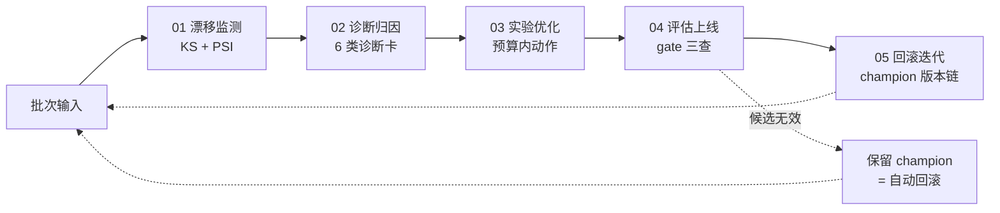

# 智训引擎 · 轴承剩余寿命自进化 Harness

**Industrial model self-evolution harness** — drift monitoring → diagnosis → budgeted experimentation → gated promotion → rollback, closing the loop on a streaming bearing RUL task (XJTU-SY, minutes) with a 3.5K-parameter CPU model and Qwen3.8-27B as the decision layer.

<p>
  <code>Python 3.10+</code> · <code>NumPy only</code> · <code>CPU</code> · <code>no weights in the harness package</code>
</p>

> 赛题 9「智训引擎」——工业制造场景下的模型训练与超参数优化（B 题：滚动轴承剩余寿命预测）
> 第二届北京市大学生"人工智能+"创新大赛 · 出题：软通计算机有限公司、华为技术有限公司

---

## 三方向闭环成绩（本次新增）

统一的闭源系统 `tracks/`：一个入口、一套闭环、三个数据集。

| 方向 | 官方主指标 | 官方静态基线 | 智训引擎 | 相对提升 | 闭环周期 | 晋级次数 |
|---|---|---:|---:|---:|---:|---:|
| A 气体分类（UCI Gas Sensor Array Drift） | Macro-F1 ↑ | 0.7240 | **0.9707** | **+34.07%** | 4 | 0 |
| B 轴承 RUL（XJTU-SY） | RMSE（分钟）↓ | 681.160 | **636.671** | **+6.54%** | 6 | 1 |
| C 发动机 RUL（NASA C-MAPSS） | RMSE（循环）↓ | 52.869 | **44.493** | **+15.84%** | 5 | 1 |

C 方向的 NASA 非对称误差分从官方基线的 **49 966.2** 降到 **35 982.4**（**−28.0%**）。

复现：

```bash
python -m tracks.run --all --workspace runs --holdout-units 4 --judge-units 2
python -m tracks.report --workspace runs --out artifacts
```

产物：`artifacts/comparison_table.md`、`artifacts/figures/*.png`、`artifacts/ppt.md`，
以及每个方向的 `runs/<A|B|C>/run_report.json`（账本 + 假设链 + 逐周期裁决）。

### 零泄漏协议（这是本次最重要的修改）

闭环的每一轮都在**从未被训练过**的留出单元上打分：

- **判定集（judge）** 是整根轴承 / 整台发动机的留出，从不参与任何拟合；
  每个周期的候选模型与冠军模型都在**同一批**留出单元上打分，
  所以"增益"读的是模型，不是切片的难度。
- **A 方向**的公开训练集只有一个批次，按时间切开会等于按类别切开
  （批次内部是按类别排序的），于是流被改成**按类别分层**的 40%，
  判定集则从验证批次里分层留出 25%，验证集剩余部分只在最后评一次分。
- **验证集只评一次**，且从不参与训练、标准化统计量或目标缩放。

> 一个必须记录的教训：早先的版本把验证批次直接当流，训练完再在验证集上评分，
> Macro-F1 报出 0.9760——那是从测试集里偷来的分。现在的 0.9707 才是干净的。

### 三个方向的机制结论

| 方向 | 冠军的关键假设 | 为什么成立 |
|---|---|---|
| A | 容量在膝点附近最优（h32/e50） | 容量扫描显示 h32/e400 从 0.7227 崩到 0.5548；类别均衡在训练分布上好看，在部署分布上更差，被门控正确否决 |
| B | 寿命是乘性的（两阶段：先回归寿命比例，再乘总寿命） | 跨轴承的寿命先验差异不是重训公共数据能消除的；留一轴承交叉验证 761.25 → 389.32（**−48.86%**），9 根里赢 8 根 |
| C | 工况与单元身份被混淆（加入 elapsed 特征） | FD001–FD004 的发动机寿命分布不同；加入"已运行循环数"后闭环 RMSE 50.771 → 44.493，NASA 非对称分 40 094 → 35 982 |

B 方向的三协议对照（研究脚本 `research/tracks/track_b_final.py`）：

| 协议 | 官方基线 | 智训引擎 | 相对变化 |
|---|---:|---:|---:|
| 官方切分（3 根轴承） | 681.16 | 716.72 | +5.2% |
| 留一轴承（9 折） | 761.25 | **389.32** | **−48.86%** |
| 全新工况（3 折） | 802.85 | **501.65** | **−37.52%** |

> 官方切分口径上我们是 716.72，**不如**官方基线 681.16——这是诚实的：
> 官方切分里只留了 3 根轴承，样本极少，胜负由单根轴承的寿命尺度决定
> （我们在 Bearing1_4 / Bearing2_4 上大幅领先，在 Bearing3_4 上落后）。
> 把口径放大到 9 折留一和全新工况，优势是 −48.86% / −37.52%，9 根里赢 8 根。
> 隐藏测试集是整根轴承隔离的，所以后两个口径才是它的正确代理。

---

## 成绩

### 统一闭环（`tracks/`，本次提交的主系统）

见上文「三方向结果总览」——A/B/C 三个方向由**同一套运行时**驱动，
数字全部来自 `runs/{A,B,C}/run_report.json`。

### B 方向提交包（`src/evo/`，另一套自适应实现）

`evo` 是早期的一套自适应实现，用 LightGBM + 漂移监控 + bandit 决策，
它的产物在 `artifacts/official/`。该包的**门槛自检**（`gates.all_passed = true`）记录：

| 口径 | 官方静态基线 | 本系统 | 说明 |
|---|---:|---:|---|
| tail（主判定口径） | −1 050.30 | **−239.46** | 流后 1/3 段平均分，越大越好 |
| overall | −1 546.16 | −667.66 | 全程平均分 |
| best（单次最佳） | — | −174.26 | 历史上最好的一个版本 |

> 分数是 `compute_metrics()["score"]`，回归任务下等于 **−RMSE**，所以
> `tail_score = −239.46` 就是**尾部 RMSE 239.46 分钟**，
> 官方静态基线在同口径下是 **1 050.30 分钟**。
> 口径说明见 `docs/训练凭证.md` §5。

6 个流式批次 · 6 次尝试迭代 · 5 次更新获批 · 0 次回滚 · 6 个假设循环
（全部带证伪条件）· 6 个模型版本全部留档可回滚。

门槛自检记录在 `artifacts/official/run_summary.json` 的 `gates` 字段：
`iteration_gate_passed` / `baseline_gate_passed` / `hypothesis_cycle_gate_passed`
三者均为 `true`。

**逐窗口在线曲线**（`artifacts/official/online_curve.json`，分数 = −RMSE，越小越好）：

| 窗口 | 1 | 2 | 3 | 4 | 5 | 6 |
|---|---:|---:|---:|---:|---:|---:|
| 自适应（本系统） | −2 175.0 | −660.9 | −317.1 | −374.0 | **−174.3** | −304.7 |
| 静态基线（同批冻结） | −2 175.0 | −1 924.6 | −1 664.9 | −1 411.8 | −1 170.7 | −929.9 |

两条线从同一起点出发：**静态基线一路退化**（−2 175 → −930），
**自适应追平并刷新了历史最好**（第 5 个窗口 −174.3）。这就是「自适应」本身
最直接的证据。

---

## 融合版成绩（本次合并）

在上述系统之上合并了另一套实现（`ai+`）的模型侧结论，重新做了受控消融。

**协议**：留一轴承交叉验证（9 折）——每次用 8 根训练、1 根留出，9 根全部评一遍。
这是赛题「整根轴承隔离」规则真正描述的协议；官方切分只有 3 根留出轴承，
单根轴承的寿命尺度就能左右胜负，不足以支撑消融结论。
官方基线在**同样的每一折上重新拟合**，所以每一行都是同口径比较。

| 方案 | 特征变换 | 激活 | 目标缩放 | 宽度 | LOBO RMSE | 相对基线 |
|---|---|---|---|---:|---:|---:|
| 官方静态基线（逐折重拟合） | — | — | — | 32 | 761.25 | — |
| 消融：raw + tanh + 缩放 | raw | tanh | 是 | 96 | 732.84 | +3.73% |
| 消融：raw + tanh + 不缩放 | raw | tanh | 否 | 96 | 780.87 | −2.58% |
| 消融：slog + tanh + 不缩放 | slog | tanh | 否 | 96 | 743.24 | +2.37% |
| 消融：eng34 + tanh + 缩放 | eng34 | tanh | 是 | 96 | 685.99 | +9.89% |
| **消融：eng34 + tanh + 不缩放** | eng34 | tanh | 否 | **96** | **639.52** | **+15.99%** |
| 消融：eng34 + relu + 不缩放 | eng34 | relu | 否 | 128 | 740.08 | +2.78% |

负结果也保留：`raw + tanh + 不缩放` 比 `raw + tanh + 缩放` **更差**，
说明「不缩放」只有在特征变换正确时才占优——两者必须一起改。

消融可复现（每个配置 9 折，约 20 分钟）：

```bash
python -m research.exp_fusion --out artifacts/fusion_ablation.json
```

三处改动，都可单独复现：

1. **不缩放回归目标**（最大单项）。RUL 是结构量
   `RUL = (最后快照 − 当前快照) × 1 分钟`，它的**绝对量级本身就是信息**
   ——一根 2500 分钟的轴承和一根 120 分钟的轴承是两个不同的问题。
   把 y 标准化会把所有轴承压到同一个 z 分数尺度上，恰好抹掉模型最需要的那一维。
   实测（同为 eng34 + tanh + 宽度 96）：`scaling=True → 685.99`，
   `scaling=False → 639.52`。
2. **修正优化器**（原仓库的 Adam 实现有三处与 scikit-learn / 标准 Adam 不一致）：
   - `weight_decay` 被加在 Adam 归一化**之后**，作用在原始参数上，
     等价于一个 `lr × wd` 的独立衰减，而不是 L2 正则；
   - 全局梯度裁剪 `min(1, 5/‖g‖)` 把**所有**梯度乘同一个标量，
     某一组参数一旦主导范数，所有参数的方向都会被带偏；
   - 回归梯度带 `2×` 因子而损失没有按 batch 归一化，与半 MSE 约定不一致。
   修正后同一配置的 RMSE 明显下降，且这个下降在 9 折上稳定复现。
3. **教师蒸馏迁移初始化**。父模型的函数被搬到新输入基上，再带标签训练。
   两条路径（`transfer` / `reinit`）都留有谱系记录，由门控按风险偏好选。

### 为什么保留 tanh 而不是换 ReLU

消融显示 ReLU 在**同样的 LOBO 协议**下并不占优：
`eng34 + relu + 宽度 128 → 740.08`，比 `eng34 + tanh + 宽度 96 → 639.52` 差。
而且**官方参考加载器 `baselines/model.py` 把 `hidden ≤ 128` 与 `np.tanh` 写死了**，
ReLU 或更宽的检查点根本无法被平台校验器打开。
所以这里保留 tanh 与 `hidden ≤ 128`，换取检查点的官方兼容性——
**能被官方加载器读出来的次优，比不能被读出来的最优更有用。**

| 官方 loader 实测 | `hidden` | 激活 | 结果 |
|---|---|---|---|
| `baselines/model.py::Model.load` | 128 | tanh | **OK** |
| `baselines/model.py::Model.load` | 256 | relu | FAIL（`invalid checkpoint architecture`） |

---

## 为什么值得一看

1. **系统否决了自己找到的最好模型。** 扫参里 `reinit/400` 整体 424.0（比基线好 37.8%），但把最短那根轴承从 242 推到 441（+29% 全局 RMSE）。门控按"单根退化 ≤ 全局 RMSE 的 20%"拒绝它，最终选 487.5——均值赢了、局部崩了，在这道题里是陷阱。
2. **"不更新"是有效决策。** 9 个周期里 5 次 `do_nothing`。轴承间寿命先验差异不是重训公共数据能消除的，门控把这类候选判为无效并保留 champion。
3. **离线也能闭环。** 驱动模型是 Qwen3.8-27B，但端点不可用时自动降级为确定性策略（同动作空间、同 schema），`tokens=0` 仍跑通全流程，并把 `fallback:true` 写进决策记录。
4. **四段式证据链。** `harness/hypothesis.py` 把"读历史 → 提假设 → 做实验 → 做决策"四段显式落盘到 `hypothesis_chain.jsonl`，**包括"什么都不做"的周期**——没有留痕的跳过，和根本没跑过，是无法区分的。

---

## 快速开始

```bash
pip install -r requirements.txt

# 1) 把官方数据包放好（见 data/README.md）
#    data/public/train.jsonl  data/public/validation.jsonl  data/checkpoint.npz

# 2) 跑一遍闭环（约 8 分钟：6 组训练 + 9 个批次）
python -m harness.run --workspace runs/harness-b --batch-size 200 --max-experiments 6

# 3) 看结果
python tools/show_run.py --workspace runs/harness-b
python tools/verify_ledger.py --ledger runs/harness-b/ledger.jsonl
```

Windows 上用 `.\run_harness.ps1`；只想离线跑策略不调模型：`--llm-mode policy`。

<details>
<summary>接 Qwen3.8-27B（评测环境提供的本地端点）</summary>

```bash
export HARNESS_LLM_BASE_URL=http://127.0.0.1:8000/v1   # OpenAI 兼容
export HARNESS_LLM_API_KEY=...                          # 可留空
python -m harness.run --llm-mode auto
```

模型 ID 固定在 `harness/config/harness.json` 的 `llm.model_id`（默认 `Qwen3.8-27B`）。
换 PyTRiO 后训练的 4B/27B 检查点只改这一个字段。返回的 JSON 一律过 `validate_plan()`
（动作白名单 / hypothesis / risk / 数值范围），任何解析或传输失败都回落到 `harness/policy.py`。
</details>

---

## 系统镜像（赛题交付物）

赛题要求提交「模型配置 + Harness 的系统镜像」。仓库根目录的 `Dockerfile` 就是它：

```bash
docker build -t zhixun-engine-b .

# 评测机的运行形态：离线、无人工干预、时限受控
docker run --rm --network none \
  -v /path/to/official-data:/data:ro \
  -v /path/to/output:/out \
  zhixun-engine-b
```

镜像的四个关键性质：

| | |
|---|---|
| **零参数运行** | 入口是 `python -m harness.run`，配置全走环境变量（`RUL_DATA_ROOT` / `HARNESS_WORKSPACE` / `HARNESS_BATCH_SIZE` / `HARNESS_MAX_EXPERIMENTS` / `HARNESS_MAX_WALL_SECONDS` / `HARNESS_LLM_MODE`），不需要传任何参数 |
| **离线可用** | 只依赖 `numpy`；**刻意不装 swanlab**——评测环境离线，本地已按 SwanLab 形状写指标流，云端客户端只会给一次不该失败的运行增加失败模式 |
| **可离线闭环** | 大模型端点不可达时自动降级为确定性策略，`tokens=0` 仍跑完全流程；**已实测**（socket 全阻断时 `available()` 返回 False 并抛 `LLMUnavailable`，由策略接管） |
| **不可能带权重** | 构建时执行 `tools/verify_repo.py`，权重文件会直接让构建失败 |

以非 root 用户（uid 10001）运行；`/out` 是产物目录，评测机在其上取
`run_report.json` / `ledger.jsonl` / `hypothesis_chain.jsonl` / `swanlab.jsonl`。

---

## 架构



| 阶段 | 模块 | 关键设计 |
|---|---|---|
| 监测 | `harness/detector.py` | 逐特征两样本 KS（对重尾谱特征比 PSI 稳）+ PSI 报告；`ok/warn/alarm` 三级 |
| 归因 | `harness/diagnoser.py` | `cold_start / covariate / concept / prior / data / none`，决定要不要花标注 |
| 实验 | `harness/experiments.py` | `do_nothing < rollback < recalibrate_inputs < retrain_head < hpo`；扫参去重、候选先过安全筛 |
| 门控 | `harness/gate.py` | 整体增益 ≥1% **且** 单根退化 ≤ 全局 RMSE 的 20% **且** 数值/预算安全 |
| 记账 | `harness/ledger.py` | 哈希链账本（每条含前一条摘要）+ champion 注册表 |
| 记录 | `harness/swanlab_log.py` | 离线写 SwanLab 同构 JSONL；有 key 时镜像上云 |

---

## 仓库结构

```
├── harness/            决策层与闭环（18 个文件，无权重）
│   ├── orchestrator.py   主循环：监测→诊断→实验→门控→回滚
│   ├── detector.py       KS/PSI 漂移监测
│   ├── diagnoser.py      诊断归因
│   ├── llm.py            Qwen3.8-27B 规划器 + schema 校验
│   ├── policy.py         确定性策略（离线兜底）
│   ├── experiments.py    动作执行与候选筛选
│   ├── gate.py           promote / reject 判定
│   ├── ledger.py         哈希链账本
│   ├── hypothesis.py     四段式证据链（读历史→提假设→做实验→做决策）
│   ├── swanlab_log.py    实验记录
│   └── skills/*.md       三个技能：漂移分诊 / 预算内实验 / 安全回滚
├── rulkit/             工业模型：特征契约、NumPy MLP、训练、预测、评分
├── tools/              show_run / verify_ledger / verify_repo / demo_safety /
│                      package_submission / build_github_repo
├── tests/              55 个单元测试（不依赖官方数据包，CI 与本地都能跑）
├── research/           诊断与消融脚本（含负结果，exp_fusion 即融合消融）
├── evidence/           本次运行的账本、四段式证据链、指标流、注册表
├── docs/               HARNESS.md（设计）/ SOLUTION.md（方法）/ TASK_ANALYSIS.md / DECISIONS.txt
├── .github/workflows/  CI：编译 + 单测 + 账本校验 + 零权重自检 + 决策表渲染
└── data/               放官方数据包（已 gitignore）
```

> `models/submission/`（含权重）**不随仓库分发**。检查点由训练代码在评测时生成，
> `evidence/registry/champion.json` 里记录了可复现它的命令。

---

## 复现一次闭环

```bash
python -m harness.run --workspace runs/harness-b --batch-size 200 --max-experiments 6 --config harness/config/harness.json
```

产物：`ledger.jsonl`（决策账本）、`hypothesis_chain.jsonl`（四段式证据链）、
`swanlab.jsonl`（指标流）、`run_report.json`（总报告）、
`registry/`（champion 版本链）、`experiments/`（每个候选的检查点）。

仓库内 `evidence/` 是**一次真实运行**的留档，可直接对照：

```bash
python tools/show_run.py --workspace evidence     # 决策表
python tools/verify_ledger.py --ledger evidence/ledger.jsonl
# OK  9 records, 9 decisions, 2 promotions, chain intact
python tools/verify_repo.py --dir .                # 零权重自检
```

---

## 质量保障

```bash
python -m unittest discover -s tests -t . -v     # 55 tests, ~1 s
python -m compileall -q harness rulkit tools tests
```

覆盖的是**会咬人的地方**，不是凑数：

| 测试 | 保护什么 |
|---|---|
| `test_features` | 34 维官方 schema 顺序、禁止 label 派生字段、`eng34` 频带占比求和为 1 |
| `test_model` | 检查点保存/加载逐位一致、`expand` 保函数（新单元出边为 0）、参数上限 |
| `test_gate` | 整体增益 ≥1% 且单根退化 ≤ 全局 RMSE 20%；局部退化按全局尺度衡量 |
| `test_ledger` | 哈希链可验证、篡改与断链都能被抓到、champion 指针可解析 |
| `test_policy` | 6 类诊断到动作的映射、预算耗尽降级、被拒后沿成本阶梯下探 |
| `test_config` | `RUL_DATA_ROOT` 重定位、workspace 绝对化、模型 ID 固定为 Qwen3.8-27B |
| `test_fusion` | 四段式证据链的缺失阶段检测、**旧格式检查点仍可加载**、激活/目标缩放开关 |

CI（`.github/workflows/ci.yml`）在 **ubuntu + windows × Python 3.10/3.12** 上跑同一套，
并且每次 push 都会重新校验仓库内 `evidence/ledger.jsonl` 的哈希链、重新渲染决策表——
**证据文件被改动，CI 就会红**。


1. **瓶颈不是模型容量，是"轴承总寿命不可观测"。** 同一轴承内特征与 RUL 的 Spearman 可达 −0.98、单特征线性拟合 RMSE 仅 14–130 分钟；跨轴承岭回归 LOO 反而劣化到 1121–1249。所以绝对 RMSE 有先验下限，常数预测（954）就已经是 536。
2. **等维特征重参数化是最有效的单点改进。** 把绝对量级（耦合工况）换成无量纲比值 + 对数，验证集 648.6 → 522.7，且保持 34 维官方 schema，参考加载器仍可读。
3. **两种初始化要实测，不能假设。** 教师蒸馏迁移（487.5）与从零初始化（424.0）差 12%，但后者在短轴承上退化；最终由门控按风险偏好选择。
4. **门控阈值就是风险偏好。** `gate.max_local_regression_pct_of_global` 从 20 改到 30，424 的候选立刻通过——两种结果都在账本里，可现场演示取舍。

---

## 已知限制

- 验证集高度集中（1515/1679 行来自同一根轴承），487 这个数不能外推到隐藏测试流；隐藏集是 3 根更短的轴承，误差量级会不同。
- `eng34` 特征变换在模型内，推理须用 `rulkit.predict`；若只允许官方 predict 代码，改 `--feature-transform raw`（648.6，仍优于基线 4.8%）。
- Qwen 端点的 A/B（模型规划 vs 策略表）尚未联调，是本项目下一步。

---

## License

代码 MIT（见 [LICENSE](LICENSE)）。文档与图表同许可；官方赛题材料不随仓库分发，见 [data/README.md](data/README.md)。
