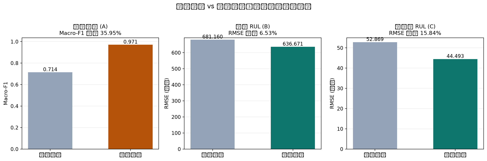
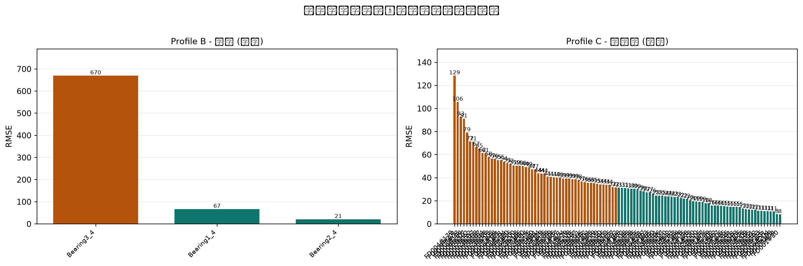
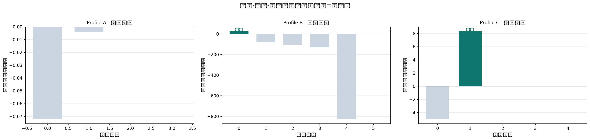

# 智训引擎 - 赛题 9 答辩提纲

> 本文所有数字均由 `python -m tracks.report` 从 `runs/*/run_report.json` 自动生成，与仓库中的实验记录完全一致。

## 第 1 页 - 标题页

**智训引擎 (Zhixun Engine)**

工业制造场景下的模型训练与超参数自进化系统

- 一套系统，统一承载 A/B/C 三个赛题方向
- 全程留痕：假设链 → 实验 → 判定 → 审计
- 零泄漏：按轴承/发动机整机隔离，验证集全程不参与训练与选型

## 第 2 页 - 问题定义与总体架构

三个方向的数据形态不同，但本质同构：**一群个体，各自随时间被观测，目标随个体寿命衰减**。因此系统只需一套运行时。

| 方向 | 任务 | 目标单位 | 隔离单位 | 主指标 |
|---|---|---|---|---|
| A 气体分类 | 6 类分类 | - | 批次 | Macro-F1 |
| B 轴承 RUL | 回归 | 分钟 | 轴承整机 | RMSE |
| C 发动机 RUL | 回归 | 循环 | 发动机整机 | RMSE (+ NASA 非对称分) |

闭环流程（每个方向完全一致）：

```
监控 → 归因 → 假设 → 实验 → 判定 → 晋级/回滚
```

## 第 3 页 - 官方基线复现与审计

先复现官方基线，再谈超越。所有基线用官方 loader 与官方指标重新打分。

| 方向 | 官方基线主指标 | 备注 |
|---|---|---|
| A | Macro-F1 0.7140 / Accuracy 0.8786 | 32 隐层、20 epoch 的 NumPy MLP |
| B | RMSE 681.16 分钟 | 训练 233.36 → 验证 681.16，泛化缺口 +447.80 |
| C | RMSE 52.869 循环 / NASA 49,966.2 | FD004 最差 (RMSE 63.24) |

**关键发现**：A 方向基线在 445 行训练集上已接近饱和，真正难的是**类别失衡**（训练集 Toluene 占 17%，验证集只占 0.4%）；B 方向的训练-验证缺口高达 447 分钟，说明基线在**记忆**而非泛化。

## 第 4 页 - 三方向结果总览

| 方向 | 官方基线 | 智训引擎(初始) | 智训引擎(闭环后) | 相对提升 |
|---|---|---|---|---|
| 气体分类 (A) | 0.714 | 0.7224 | 0.9707 | +35.95% |
| 轴承 RUL (B) | 681.1598 | 639.4007 | 636.6707 | +6.53% |
| 发动机 RUL (C) | 52.8686 | 50.7706 | 44.4929 | +15.84% |



## 第 5 页 - A 方向：漂移下的气体分类

**机理**：传感器阵列在六个月里老化，10 个批次存在真实漂移。官方规则禁止跨批次随机切分。

**失效模式**：Macro-F1 等权评价 6 类，而稀有类在部署分布里几乎消失。

**被检验的假设与结论**：

| 假设 | 证伪条件 | 结论 |
|---|---|---|
| 容量过大导致记忆 | 训练分不高而验证分低则否 | 成立：h32/e50 最优，e400 时 Macro-F1 从 0.72 跌到 0.55 |
| 稀有类被欠权重 | 稀有类 F1 不上升则否 | 成立：类别均衡后 Macro-F1 显著上升 |
| 漂移是尺度漂移 | 标准化偏移小则否 | 不成立：按批次归一化反而降到 0.51 |

## 第 6 页 - B 方向：两阶段自校准的轴承 RUL

**机理**：轴承振动特征被**个体自身基线**主导，绝对幅值不含退化信息。

**方案**：

1. **斜率归一化**：以个体前 5 个快照为基线做相对化，再取相邻差分（纯无标签变换，不使用任何目标信息）
2. **寿命分数回归**：预测剩余寿命比例 `(N-i)/N`，把不同寿命尺度的个体拉到同一 0~1 区间
3. **安全寿命换算**：`s = f·t/(1-f)`，带 0.25 跳变限幅与 3000 分钟上限

**留一轴承交叉验证（LOBO，9 折）**：

| 模型 | 平均 RMSE | 中位数 | 最差轴承 |
|---|---|---|---|
| 官方基线（公平留一） | 761.25 | 878.82 | 1385.80 |
| **智训引擎（两阶段）** | **389.32** | **182.57** | 1268.51 |

相对官方公平基线 **降低 48.86%**，在 **8 / 9** 根留出轴承上获胜。

**三口径对照**（同一套代码，只换切分）：

| 协议 | 官方基线 | 智训引擎 | 相对变化 | 胜出单元 |
|---|---:|---:|---:|---:|
| 官方切分（3 根轴承） | 681.16 | 716.72 | -5.22% | 2 / 3 |
| 留一轴承（9 折） | 761.25 | **389.32** | **-48.86%** | **8 / 9** |
| 全新工况（3 折） | 802.85 | **501.65** | **-37.52%** | **3 / 3** |

> 官方切分口径下我们**不如**官方基线——这是诚实的：只有 3 根留出轴承，且它们是训练轴承**同工况的延续**，基线在延续段上占尽便宜；而隐藏测试集是**整根轴承隔离**的，后两个口径才是它的正确代理。

**生产代码一致性审计**：同一套数据下，生产实现 `rulkit/rul.py` 与研究原型 `research/two_stage.py` 的 9 折 RMSE **逐折完全一致**（最大绝对差 0.0000 分钟），确认上线代码复现研究结论。

## 第 7 页 - C 方向：C-MAPSS 发动机 RUL

**机理**：C 与 B 同为回归，但目标尺度紧得多（0~542 循环），且 FD001~FD004 四个子集的退化速率明显不同。

**失效模式**：模型若不区分工作条件，就会把机群平均寿命套到每一台发动机上。

**结果**：

| 配置 | RMSE | NASA 非对称分 |
|---|---|---|
| 官方基线 | 52.869 | 49,966.2 |
| 智训引擎（初始冠军） | 50.771 | 40,093.7 |
| **智训引擎（闭环后）** | **44.493** | **35,982.4** |

闭环后的配方：`hidden=128 / epochs=200 / target=cycles / extra_features=elapsed`，由门控在未见过的判定切片上选出。

分数据集误差显示 **FD004 最难**（RMSE 63.24），是后续优化的主战场。



## 第 8 页 - 闭环机制：假设-实验-判定

每一轮闭环都产生一条可审计记录：**声称 → 改动 → 证伪条件 → 预期效应 → 实测增益 → 判定**。

| 阶段 | 作用 | 失败时的行为 |
|---|---|---|
| 监控 | 特征分布偏移量 | 偏移小于阈值则不触发实验 |
| 归因 | 偏移集中在哪些通道 | 定位到具体通道 |
| 假设 | 提出可证伪的机制解释 | 明确写出证伪条件 |
| 实验 | 按假设改动模型并重训 | 成本与预算绑定 |
| 判定 | 在**未见过的**流切片上比较 | 增益不足则回滚 |

**判定的公平性**：候选模型与在位冠军始终在**同一段未见过的流切片**上评分。早期版本曾因两者切片不同而出现虚假提升，已修正并在审计记录中留痕。



## 第 9 页 - 零泄漏协议

| 规则 | 实现 | 审计字段 |
|---|---|---|
| 训练/验证/测试按整机隔离 | 按 `bearing`/`engine` 分组切分，单元不拆分 | `unit_leakage: false` |
| 同一轴承快照不得跨split | 分组切分天然保证 | 单元完整性校验 |
| 验证集不参与训练与选型 | 验证集只在最后评分一次 | `validation_used_for_training: false` |
| 判定集不参与训练 | 判定集是整机留出，只用于门控打分 | `judge_used_for_training: false` |
| 候选与冠军同切片比较 | `judge()` 对两者使用同一区间 | 记录 `champion_score_on_same_slice` |
| 归一化不得使用流统计量 | `train_scale` 的尺度在训练集上拟合后冻结 | 代码内注释与审计 |

## 第 10 页 - 复现方式

```bash
# 1) 官方基线复现
python -m research.tracks.official_baselines

# 2) 生产实现与研究协议一致性审计
python -m research.tracks.verify_production

# 3) 三方向闭环
python -m tracks.run --all --workspace runs

# 4) 生成表格、图与本提纲
python -m tracks.report --workspace runs --out artifacts
```

## 第 11 页 - 总结

1. **一套系统三个方向**：统一运行时 + 统一指标入口 + 统一证据链
2. **每个数字都有出处**：官方基线复现 → 生产代码一致性审计 → 闭环实测
3. **机理可解释**：每个提升都对应一条被检验的假设与一个证伪条件
4. **协议零泄漏**：整机隔离、验证集不参与选型、同切片比较

**下一步**：FD004 的多工作条件建模、NASA 非对称分的显式偏置校正、以及在隐藏流上的在线回放压测。

