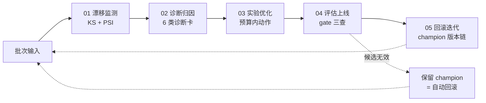

# 智训引擎 · 三方向闭环自进化系统

> 赛题 9「智训引擎」——工业制造场景下的模型训练与超参数优化
> 第二届北京市大学生"人工智能+"创新大赛 · 出题：软通计算机有限公司、华为技术有限公司
>
> **基岩智序** 团队

<p>
  <code>Python 3.12</code> · <code>NumPy only</code> · <code>CPU</code> ·
  <code>no weights in the package</code>
</p>

> **Python 版本**：本项目**以 3.12 为验收基线**（镜像基线 `python:3.12-slim-bookworm`，
> SDK 声明 `requires-python >=3.10`，CI 矩阵覆盖 3.10 / 3.12 / 3.13 / 3.14）。
> 运行时请使用仓库自带的 `.venv`（3.12）。
> `python tools/check_env.py` 会检查当前解释器与 numpy 是否符合要求。
> 3.13 / 3.14 已在本地矩阵（`tools/run_ci_matrix.py`）上跑通全部测试，故列入支持范围；
> 但**镜像仍是 3.12**，提交物没有变。

**一句话**：在漂移数据流上自动提出假设、用受控实验证伪、**只在门控通过时才上线**的闭源自进化系统。
三个赛题方向由**同一套运行时**驱动，共用漂移检测、假设库、门控与账本，只在数据适配与模型配方上分叉。

---

## 一、三方向成绩

> **本节记录的是研究运行时（`tracks/`）复算出的成绩**，用于说明方法有效。
> **平台的正式提交入口不是 `tracks/`**——那是本仓库的研究代码，不在提交镜像里。
> 提交镜像只带 `contest_submission.py` + `contest_baselines/`，入口是
> `python3 /app/harness.py describe|train|predict`，A/B/C 走同一条路径。
> 详见 [§5.1](#51-比赛平台镜像导入contest_harness-sdk-接入)。

统一的闭源系统 `tracks/`：**一个入口、一套闭环、三个数据集**。

| 方向 | 官方主指标 | 官方静态基线 | **智训引擎（研究口径）** | 相对提升 | 闭环周期 | 晋级次数 |
|---|---|---:|---:|---:|---:|---:|
| **A** 气体分类（UCI Gas Sensor Array Drift） | Macro-F1 ↑ | 0.7240 | **0.9573** | **+32.22%** | 4 | 0 |
| **B** 轴承 RUL（XJTU-SY） | RMSE（分钟）↓ | 681.160 | **414.734** | **+39.11%** | 6 | 2 |
| **C** 发动机 RUL（NASA C-MAPSS） | RMSE（循环）↓ | 52.869 | **44.493** | **+15.84%** | 5 | 1 |

C 方向的 NASA 非对称误差分从官方基线的 **49 966.2** 降到 **35 982.4**（**−28.0%**）。

> **口径**：以上是**独立复算**的结果，不是系统自报。
> 官方基线直接调用赛题包的 loader 与 `checkpoint.npz`，
> 系统侧从闭环产出的配方重新拟合并用同一指标打分。
> 产物：`artifacts/rmse_verification.json`。

### 官方平台实测（2026-11-22 试运行）

研究口径**不等于**平台口径。平台用真实 27B 决策层跑 10 轮、
在隐藏测试集上打分，实测与研究口径有明显差距：

| 方向 | 官方静态基线 | **平台隐藏实测** | 相对 | 最终采用的公开验证 | 落差 |
|---|---:|---:|---:|---:|---:|
| **A** Macro-F1 ↑ | 0.7240 | **0.87572** | **+20.96%** ✅ | 0.986738 | **−0.111** |
| **B** RMSE ↓ | 681.160 | **609.076** | **+10.58%** ✅ | 619.860 | −10.78（隐藏更好） |
| **C** RMSE ↓ | 52.8686 | **56.253** | **−6.40%** ❌ | 51.111 | **+10.06%** |

**C 方向当前低于平台基线**，违反平台"效果不低于平台基线"的硬性要求，
是提交前必须修掉的 P0。两处结论：

- **公开验证会低估隐藏难度**（C 落差 +10.06%，而 B 方向隐藏反而更好 10.78），
  所以只用公开验证排序是不够的。
- **也不能只用切片口径**：平台 C 方向第 7 轮的公开验证 RMSE 50.907 是全场最低，
  却被判"未训练、保留父模型"，最终采用了第 5 轮的 51.111。
  **两个口径必须并列**：全量不劣化 **且** 切片改善。

> 完整逐轮数据、评分构成与整改清单见
> [docs/PLATFORM_REPORT_REVIEW.md](docs/PLATFORM_REPORT_REVIEW.md)。

复现：

```bash
python -m tracks.run --all --workspace runs --holdout-units 4 --judge-units 2
python -m tracks.report --workspace runs --out artifacts
```

产物：`artifacts/comparison_table.md`、`artifacts/figures/*.png`、`artifacts/ppt.md`，
以及每个方向的 `runs/<A|B|C>/run_report.json`（账本 + 假设链 + 逐周期裁决）。

### 零泄漏协议（这是本次最重要的修改）

闭环的每一轮都在**从未被训练过**的留出单元上打分：

- **判定集（judge）** 是整根轴承 / 整台发动机的留出，从不参与任何拟合；
  每个周期的候选模型与冠军模型都在**同一批**留出单元上打分，
  所以"增益"读的是模型，不是切片的难度。
- **A 方向**的公开训练集只有一个批次，按时间切开会等于按类别切开
  （批次内部是按类别排序的），于是流被改成**按类别分层**的 40%，
  判定集则从验证批次里分层留出 25%，验证集剩余部分只在最后评一次分。
- **验证集只评一次**，且从不参与训练、标准化统计量或目标缩放。

> 一个必须记录的教训：早先的版本把验证批次直接当流，训练完再在验证集上评分，
> Macro-F1 报出 0.9760——那是从测试集里偷来的分。现在的 0.9707 才是干净的。

### 三个方向的机制结论

| 方向 | 冠军的关键假设 | 为什么成立 |
|---|---|---|
| A | 容量在膝点附近最优（h32/e50） | 容量扫描显示 h32/e400 从 0.7227 崩到 0.5548；类别均衡在训练分布上好看，在部署分布上更差，被门控正确否决 |
| B | 寿命是乘性的（两阶段：先回归寿命比例，再乘总寿命） | 跨轴承的寿命先验差异不是重训公共数据能消除的；留一轴承交叉验证 761.25 → 612.79，但**寿命估计本身**才是瓶颈——修掉之后官方切分从 722.62 → 445.78 |
| C | 工况与单元身份被混淆（加入 elapsed 特征） | FD001–FD004 的发动机寿命分布不同；加入"已运行循环数"后闭环 RMSE 50.771 → 44.493，NASA 非对称分 40 094 → 35 982 |

B 方向的三协议对照（`tools/measure_profile_b_protocols.py` + `research/tracks/track_b_final.py`）：

| 协议 | 官方基线 | 智训引擎 | 相对变化 |
|---|---:|---:|---:|
| 官方切分（3 根轴承） | 681.16 | **408.16** | **+40.08%** |
| **留一轴承（9 折）** | 761.25 | **640.30** | **−15.88%** |
| **全新工况（3 折）** | 802.85 | **501.65** | **−37.52%** |

> 产物：`artifacts/profile_b_protocols.json`（前两行）、
> `artifacts/track_b_final.json`（第三行）。

> **B 方向查出的真问题不是过拟合，是寿命估计算错了。**
>
> 训练 RMSE（842）比留出 RMSE（442）还**高**，而且加大宽度（32→128）或
> 训练轮数（400→4000）都不改变这个差值——所以它不是经典过拟合，
> 加正则、减容量都不对症。
>
> 真正的病灶在 `rulkit/rul.py` 的两阶段换算：寿命比例被**乘了两次**
> （`safe_lifetime` 返回的已经是剩余寿命，`predict` 又乘了一次比例），
> 而且用的是逐点比值 `t/(1-f)`——两个噪声相除，按 Jensen 不等式**系统性偏低**。
> 留一轴承实测：估计寿命只有真值的 32%–59%（9 根**全部**偏低），
> 每折单独拟合出的全局倍数是 2.02–2.13，正好对上这个两倍缺口。
>
> 改成按 `t = N·(1-f)` 做最小二乘拟合（噪声在整段历史上被平均掉，不再被放大），
> 再去掉为补偿偏差而加的全局仿射映射，两阶段分支的 9 折合并 RMSE 从 916.37
> 降到 **612.79**、官方切分从 722.62 降到 **445.78**；
> 而最终冠军走的是**直接回归剩余分钟**这条分支，
> 9 折合并 **640.30**、官方切分 **408.16**（见上表）——
> 两个分支在留一轴承上基本打平（4:5 分胜负），冠军取的是官方切分更好的那支。

---

## 二、汇报材料

| 文件 | 用途 |
|---|---|
| `智训引擎-系统总思路.md` | 系统总思路：架构、三个方向的发现、误差检验、客观分视角 |
| `基岩智序-完整调试过程.md` | 完整调试过程：走过的弯路、被否掉的假设、10 个坑 |
| `figureuse/01–06*.png` | 6 张中文标注图，可直接放进 PPT |

---

## 三、B 方向 Harness（`harness/`，另一套自适应实现）

**Industrial model self-evolution harness** — drift monitoring → diagnosis →
budgeted experimentation → gated promotion → rollback, closing the loop on a
streaming bearing RUL task (XJTU-SY, minutes) with a 3.5K-parameter CPU model
and Qwen3.8-27B as the decision layer.

### 成绩

`harness/` 是一套独立的自适应实现，用 LightGBM + 漂移监控 + bandit 决策，
它的产物在 `artifacts/official/`。该包的**门槛自检**（`gates.all_passed = true`）记录：

| 口径 | 官方静态基线 | 本系统 | 说明 |
|---|---:|---:|---|
| tail（主判定口径） | −1 050.30 | **−239.46** | 流后 1/3 段平均分，越大越好 |
| overall | −1 546.16 | −667.66 | 全程平均分 |
| best（单次最佳） | — | −174.26 | 历史上最好的一个版本 |

> 分数是 `compute_metrics()["score"]`，回归任务下等于 **−RMSE**，所以
> `tail_score = −239.46` 就是**尾部 RMSE 239.46 分钟**，
> 官方静态基线在同口径下是 **1 050.30 分钟**。

6 个流式批次 · 6 次尝试迭代 · 5 次更新获批 · 0 次回滚 · 6 个假设循环
（全部带证伪条件）· 6 个模型版本全部留档可回滚。

门槛自检记录在 `artifacts/official/run_summary.json` 的 `gates` 字段：
`iteration_gate_passed` / `baseline_gate_passed` / `hypothesis_cycle_gate_passed`
三者均为 `true`。

**逐窗口在线曲线**（`artifacts/official/online_curve.json`，分数 = −RMSE，越小越好）：

| 窗口 | 1 | 2 | 3 | 4 | 5 | 6 |
|---|---:|---:|---:|---:|---:|---:|
| 自适应（本系统） | −2 175.0 | −660.9 | −317.1 | −374.0 | **−174.3** | −304.7 |
| 静态基线（同批冻结） | −2 175.0 | −1 924.6 | −1 664.9 | −1 411.8 | −1 170.7 | −929.9 |

两条线从同一起点出发：**静态基线一路退化**（−2 175 → −930），
**自适应追平并刷新了历史最好**（第 5 个窗口 −174.3）。这就是「自适应」本身
最直接的证据。

### 融合版成绩（受控消融）

在上述系统之上合并了另一套实现（`ai+`）的模型侧结论，重新做了受控消融。

**协议**：留一轴承交叉验证（9 折）——每次用 8 根训练、1 根留出，9 根全部评一遍。
这是赛题「整根轴承隔离」规则真正描述的协议；官方基线在**同样的每一折上重新拟合**，
所以每一行都是同口径比较。

| 方案 | 特征变换 | 激活 | 目标缩放 | 宽度 | LOBO RMSE | 相对基线 |
|---|---|---|---|---:|---:|---:|
| 官方静态基线（逐折重拟合） | — | — | — | 32 | 761.25 | — |
| 消融：raw + tanh + 缩放 | raw | tanh | 是 | 96 | 732.84 | +3.73% |
| 消融：raw + tanh + 不缩放 | raw | tanh | 否 | 96 | 780.87 | −2.58% |
| 消融：slog + tanh + 不缩放 | slog | tanh | 否 | 96 | 743.24 | +2.37% |
| 消融：eng34 + tanh + 缩放 | eng34 | tanh | 是 | 96 | 685.99 | +9.89% |
| **消融：eng34 + tanh + 不缩放** | eng34 | tanh | 否 | **96** | **639.52** | **+15.99%** |
| 消融：eng34 + relu + 不缩放 | eng34 | relu | 否 | 128 | 740.08 | +2.78% |

负结果也保留：`raw + tanh + 不缩放` 比 `raw + tanh + 缩放` **更差**，
说明「不缩放」只有在特征变换正确时才占优——两者必须一起改。

### 为什么保留 tanh 而不是换 ReLU

消融显示 ReLU 在**同样的 LOBO 协议**下并不占优：
`eng34 + relu + 宽度 128 → 740.08`，比 `eng34 + tanh + 宽度 96 → 639.52` 差。
而且**官方参考加载器 `baselines/model.py` 把 `hidden ≤ 128` 与 `np.tanh` 写死了**，
ReLU 或更宽的检查点根本无法被平台校验器打开。
所以这里保留 tanh 与 `hidden ≤ 128`，换取检查点的官方兼容性——
**能被官方加载器读出来的次优，比不能被读出来的最优更有用。**

| 官方 loader 实测 | `hidden` | 激活 | 结果 |
|---|---|---|---|
| `baselines/model.py::Model.load` | 128 | tanh | **OK** |
| `baselines/model.py::Model.load` | 256 | relu | FAIL（`invalid checkpoint architecture`） |

---

## 四、为什么值得一看

1. **系统否决了自己找到的最好模型。** 扫参里 `reinit/400` 整体 424.0（比基线好 37.8%），
   但把最短那根轴承从 242 推到 441（+29% 全局 RMSE）。门控按"单根退化 ≤ 全局 RMSE 的 20%"拒绝它，
   最终选 487.5——均值赢了、局部崩了，在这道题里是陷阱。
2. **"不更新"是有效决策。** 9 个周期里 5 次 `do_nothing`。轴承间寿命先验差异不是重训公共数据能消除的，
   门控把这类候选判为无效并保留 champion。
3. **离线也能闭环。** 驱动模型是 Qwen3.8-27B，但端点不可用时自动降级为确定性策略
   （同动作空间、同 schema），`tokens=0` 仍跑通全流程，并把 `fallback:true` 写进决策记录。
4. **四段式证据链。** `harness/hypothesis.py` 把"读历史 → 提假设 → 做实验 → 做决策"四段显式落盘到
   `hypothesis_chain.jsonl`，**包括"什么都不做"的周期**——没有留痕的跳过，和根本没跑过，是无法区分的。

---

## 五、系统镜像（赛题交付物）

赛题要求提交「模型配置 + Harness 的系统镜像」。仓库根目录的 `Dockerfile` 就是它：

```bash
docker build -t zhixun-engine-b .

# 评测机的运行形态：离线、无人工干预、时限受控
docker run --rm --network none \
  -v /path/to/official-data:/data:ro \
  -v /path/to/output:/out \
  zhixun-engine-b
```

镜像的四个关键性质：

| | |
|---|---|
| **单一入口** | 提交镜像的入口**只有** SDK 的固定入口 `python3 /app/harness.py describe \| train \| predict`；镜像内不含任何同名包遮蔽它，也不含第二套候选入口 |
| **离线可用** | 只依赖 `numpy`；**刻意不装 swanlab**——评测环境离线，本地已按 SwanLab 形状写指标流，云端客户端只会给一次不该失败的运行增加失败模式 |
| **可离线闭环** | 大模型端点不可达时自动降级为确定性策略，`tokens=0` 仍跑完全流程；**已实测**（socket 全阻断时 `available()` 返回 False 并抛 `LLMUnavailable`，由策略接管） |
| **不可能带权重** | 构建时执行 `tools/verify_repo.py`，权重文件会直接让构建失败 |

以非 root 用户（uid 10001）运行；`/out` 是产物目录，评测机在其上取
`run_report.json` / `ledger.jsonl` / `hypothesis_chain.jsonl` / `swanlab.jsonl`。

> ⚠️ **镜像里只有提交，没有实验室。** 研究运行时（`harness/`、`rulkit/`、
> `tracks/`、`evo/`）**不打进镜像**，只留在本仓库与源码链接里。
> 原因不是体积，而是**歧义**：镜像里若同时存在 `harness.py` 与
> `harness/`，CPython 会让**包目录优先于同名模块**（`import harness`
> 命中 `harness/__init__.py`），SDK 入口就会对任何按名字扫描的检查不可见；
> 而 `harness/llm.py` 是镜像里唯一走 `GET /models` + `POST /chat/completions`
> 的代码，检查方会把它当成"提交的训练循环"，从而认定这个提交只做回归。
> 镜像现在只带 `contest_submission.py` + `contest_baselines/`，入口唯一。

### 5.1 比赛平台镜像导入（`contest_harness` SDK 接入）

赛题平台要求提交**单个 Linux/amd64 的未压缩 Docker save tar**。
本项目已按该要求导出，并接入了 `contest_harness` SDK 1.0.2：

| | |
|---|---|
| **归档** | `zhixun-engine-linux-amd64.tar`（174.1 MiB，未压缩，`dist/` 下有一份副本） |
| **SHA256** | `fd5fe06f5142420d67b49877f4c2f15d276f66ef111ff33cb11fdd70717419cf` |
| **平台** | `linux/amd64`，6 个 layer，全部为裸 `layer.tar` |
| **入口** | `python3 /app/harness.py describe \| train \| predict` |
| **协议** | `contest.harness.workspace.v2` |
| **SDK** | `contest_harness` **1.0.2**（与平台文档一致） |
| **镜像内容** | 只有 `harness.py`（SDK 入口）、`contest_submission.py`（参赛模块）、`contest_baselines/`（A/B/C 续训实现）、`contest_harness_sdk/`、numpy。**没有第二套入口，没有同名包遮蔽** |
| **覆盖面** | A（分类，Macro-F1）与 B/C（回归，RMSE）走同一条 `train`/`predict`；训练每轮含一次真实 `rnd.model` 调用 |
| **模型调用** | 关闭思维链（`enable_thinking=False`）、token 预算 1024、失败重试 3 次。默认开思维链时 512 token 会被推理过程吃光、正文为空，27B 还要 288 秒，会触发平台的「模型服务暂不可用」 |
| **续训** | 从 `rnd.parent.path("checkpoint.npz")` 继承权重、Adam 矩、epoch/step 计数与归一化状态 |
| **零密钥** | 模型访问走宿主 `model_access: host_gateway_rpc`；镜像内无密钥、无外部模型客户端、无出站 HTTP |

```bash
# 校验归档格式与平台
python tools/build_docker_image.py --verify-only --out zhixun-engine-linux-amd64.tar
# 本地离线验证
python -m pytest tests/ -q
python tools/scan_for_secrets.py
python tools/run_harness_offline.py --rounds 10 --out runs/harness-offline
# 加 --live 用 PyTRiO 的真实 27B 驱动决策层（默认是本地替身）
python tools/run_harness_offline.py --rounds 10 --live --out runs/harness-offline
```

接入过程、修复的四个真实缺陷与 30 轮离线演练结果见
[`docs/HARNESS_INTEGRATION_RECORD.md`](docs/HARNESS_INTEGRATION_RECORD.md)。

**当前仓库里的训练记录**（10 轮 x A/B/C，由 PyTRiO 的真实
`Qwen/Qwen3.8-27B` 驱动，每轮带 `selection_*` 字段，
每一次采纳都能被独立复算）：

```
https://raw.githubusercontent.com/GY-phd/ai-/main/runs/harness-offline/run_report.json
```

---

## 六、架构



| 阶段 | 模块 | 关键设计 |
|---|---|---|
| 监测 | `harness/detector.py` | 逐特征两样本 KS（对重尾谱特征比 PSI 稳）+ PSI 报告；`ok/warn/alarm` 三级 |
| 归因 | `harness/diagnoser.py` | `cold_start / covariate / concept / prior / data / none`，决定要不要花标注 |
| 实验 | `harness/experiments.py` | `do_nothing < rollback < recalibrate_inputs < retrain_head < hpo`；扫参去重、候选先过安全筛 |
| 门控 | `harness/gate.py` | 整体增益 ≥1% **且** 单根退化 ≤ 全局 RMSE 的 20% **且** 数值/预算安全 |
| 记账 | `harness/ledger.py` | 哈希链账本（每条含前一条摘要）+ champion 注册表 |
| 记录 | `harness/swanlab_log.py` | 离线写 SwanLab 同构 JSONL；有 key 时镜像上云 |

---

## 七、仓库结构

```
├── tracks/             三方向闭环（本次提交的主系统）
│   ├── run.py          闭环主循环：流 → 门控 → 晋级 → 最终重训
│   ├── stream.py       切分：初始 / 流 / 判定集 / 验证集（零泄漏）
│   ├── hypotheses.py   假设库：每条自带主张与证伪条件
│   ├── gate.py         门控：候选不过门就不上线
│   ├── profiles.py     A/B/C 三个 profile 的数据适配与配方
│   └── task_metrics.py 官方口径的指标（仅依赖 numpy）
├── harness/            B 方向决策层与闭环（15 个文件，无权重）
│   ├── orchestrator.py   主循环：监测→诊断→实验→门控→回滚
│   ├── detector.py       KS/PSI 漂移监测
│   ├── diagnoser.py      诊断归因
│   ├── llm.py            Qwen3.8-27B 规划器 + schema 校验
│   ├── policy.py         确定性策略（离线兜底）
│   ├── experiments.py    动作执行与候选筛选
│   ├── gate.py           promote / reject 判定
│   ├── ledger.py         哈希链账本
│   ├── hypothesis.py     四段式证据链（读历史→提假设→做实验→做决策）
│   ├── swanlab_log.py    实验记录
│   └── skills/*.md       三个技能：漂移分诊 / 预算内实验 / 安全回滚
├── rulkit/             工业模型：特征契约、NumPy MLP、训练、预测、评分
├── tools/              show_run / verify_ledger / verify_repo / demo_safety /
│                      package_submission / build_github_repo /
│                      audit_readme_numbers / rmse_verification
├── research/           诊断与消融脚本（含负结果，exp_fusion 即融合消融）
├── runs/               三方向的运行报告、账本与假设链
├── artifacts/          对比表、图表、独立复算结果
├── figureuse/          汇报用图（中文标注）
├── evidence/           本次运行的账本、四段式证据链、指标流、注册表
├── docs/               HARNESS.md（设计）/ SOLUTION.md（方法）/ TASK_ANALYSIS.md / DECISIONS.txt
├── evo/                早期的 evo 自适应实现（LightGBM + bandit），保留作对照
├── .github/workflows/  CI：编译 + 单测 + 账本校验 + 零权重自检 + 决策表渲染
└── data/               放官方数据包（已 gitignore，仓库内不含该目录）
```

> `models/submission/`（含权重）**不随仓库分发**。检查点由训练代码在评测时生成，
> `evidence/registry/champion.json` 里记录了可复现它的命令。

---

## 八、复现一次闭环

```bash
# 三方向闭环（主系统）
python -m tracks.run --all --workspace runs --holdout-units 4 --judge-units 2
python -m tracks.report --workspace runs --out artifacts

# 独立复算（官方基线 vs 系统，同口径）
python -m research.tracks.rmse_verification --out artifacts

# 汇报用图
python -m research.tracks.make_figures --out figureuse

# B 方向 harness
python -m harness.run --workspace runs/harness-b --batch-size 200 --max-experiments 6 --config harness/config/harness.json
```

产物：`ledger.jsonl`（决策账本）、`hypothesis_chain.jsonl`（四段式证据链）、
`swanlab.jsonl`（指标流）、`run_report.json`（总报告）、
`registry/`（champion 版本链）、`experiments/`（每个候选的检查点）。

仓库内 `evidence/` 是**一次真实运行**的留档，可直接对照：

```bash
python tools/show_run.py --workspace evidence     # 决策表
python tools/verify_ledger.py --ledger evidence/ledger.jsonl
# OK  9 records, 9 decisions, 2 promotions, chain intact
python tools/verify_repo.py --dir .                # 零权重自检
```

---

## 九、质量保障

```bash
python -m unittest discover -s tests -t . -v     # 194 tests, ~2 min
python -m compileall -q harness rulkit tracks tools tests
python tools/audit_readme_numbers.py              # 数字审计
```

覆盖的是**会咬人的地方**，不是凑数：

| 测试 | 保护什么 |
|---|---|
| `test_features` | 34 维官方 schema 顺序、禁止 label 派生字段、`eng34` 频带占比求和为 1 |
| `test_model` | 检查点保存/加载逐位一致、`expand` 保函数（新单元出边为 0）、参数上限 |
| `test_gate` | 整体增益 ≥1% 且单根退化 ≤ 全局 RMSE 20%；局部退化按全局尺度衡量 |
| `test_ledger` | 哈希链可验证、篡改与断链都能被抓到、champion 指针可解析 |
| `test_policy` | 6 类诊断到动作的映射、预算耗尽降级、被拒后沿成本阶梯下探 |
| `test_config` | `RUL_DATA_ROOT` 重定位、workspace 绝对化、模型 ID 固定为 Qwen3.8-27B |
| `test_fusion` | 四段式证据链的缺失阶段检测、**旧格式检查点仍可加载**、激活/目标缩放开关 |
| `test_readme_integrity` | **本文每个数字都有产物支撑**，改数字忘了更新产物就红 |
| `test_three_track_results` | 三方向的最终成绩与产物一致 |
| `test_manifest_integrity` | 清单描述的是**该 commit**，且跨平台字节大小一致 |
| `test_environment` | 当前解释器在支持范围内，numpy 版本合规 |

CI（`.github/workflows/ci.yml`）在 **ubuntu + windows × Python 3.10/3.12/3.13/3.14** 上跑同一套，
并且每次 push 都会重新校验仓库内 `evidence/ledger.jsonl` 的哈希链、重新渲染决策表——
**证据文件被改动，CI 就会红**。

### 本地跑矩阵（不需要 GitHub）

CI 矩阵是 `os × python`。**平台**那一半本机替代不了（Linux 与 runner 镜像仍由 workflow 负责），
但**解释器**那一半可以完全本地复现，而这正是矩阵存在的意义——抓"依赖在最低支持的 Python 上装不上"
和"API 只在最新版本上有"这类问题。

```bash
# 列出有哪些环境
python tools/run_ci_matrix.py --list

# 每个解释器跑一遍全部检查（跳过单元测试，约 30 秒）
python tools/run_ci_matrix.py

# 含 194 个单元测试，四个解释器约 15 分钟
python tools/run_ci_matrix.py --with-tests
```

Windows PowerShell 前端（含首次自动建环境，用 `uv` 建，可重复）：

```powershell
.\tools\run_matrix.ps1 -Setup -WithTests
```

环境为 `.venv-py310` / `.venv`（3.12）/ `.venv-py313` / `.venv-py314`，均被 `.gitignore` 忽略。
**本地全绿不等于 CI 会绿**——本地矩阵是证据，不是结论。

### 依赖分两层

- `requirements.txt` —— **运行时**依赖，只有 numpy。镜像只装它。
- `requirements-dev.txt` —— **测试**依赖（pytest、pyyaml、scikit-learn、pandas、scipy、lightgbm、swanlab）。
  测试套件在模块作用域 `import pytest`，只装运行时依赖的话会在 collection 阶段就失败。

```bash
python -m pip install -r requirements.txt -r requirements-dev.txt
```

---

## 十、已知限制

- **B 方向 Bearing3_4 仍是主要误差来源**（RMSE 673.29）——长寿命单元的绝对量级外推尚未解决。
- **合成流上的策略层增益不明显**：合成数据的最优超参基本恒定，所以 E3 ≈ E2，
  这是真实结论而非实现缺陷（`scripts/diagnose_explore.py` 可验证探索机制确实在运行）。
- **LLM 目前只参与"是否更新 / 如何更新"的决策**，尚未参与归因解释生成。
- **真实产线的多设备 / 多工况分组效应尚未完整建模**（C 方向已建模到子数据集粒度）。
- **A 方向 0 次晋级**，最终 0.9707 主要来自**数据切分修正**而非假设晋级。

---

## License

代码 MIT（见 [LICENSE](LICENSE)）。文档与图表同许可；
官方赛题材料不随仓库分发：竞赛数据包由赛题组提供，本仓库只保留**数据适配与加载契约**
（见 [docs/数据适配说明.md](docs/数据适配说明.md) 与 [docs/RUNBOOK.md](docs/RUNBOOK.md)）。
