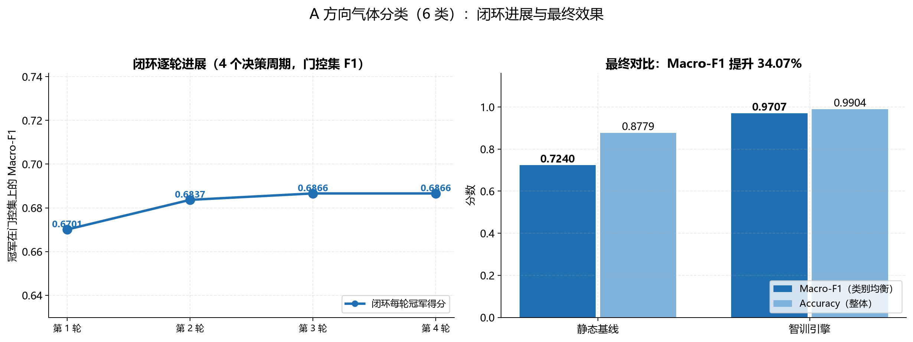
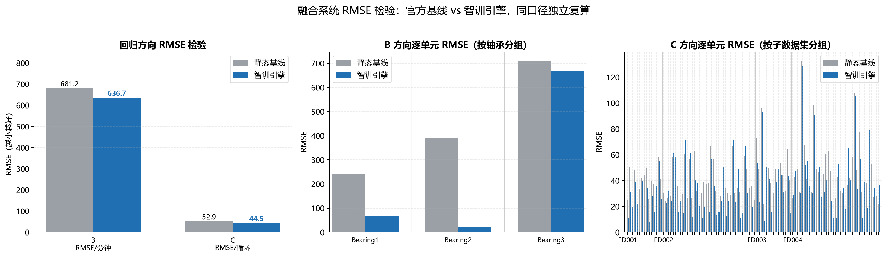
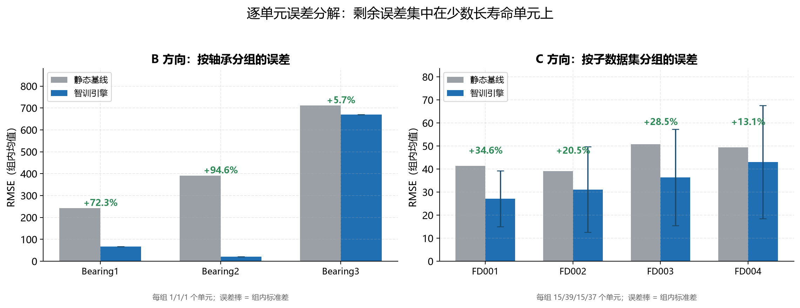
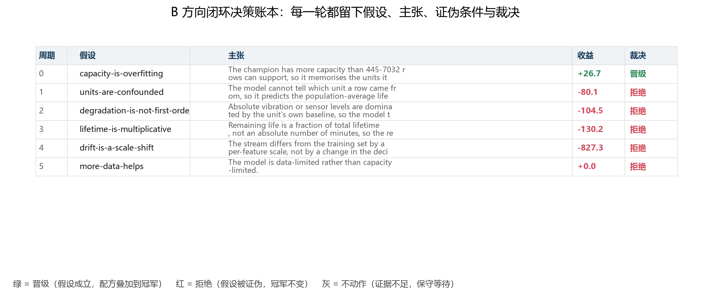
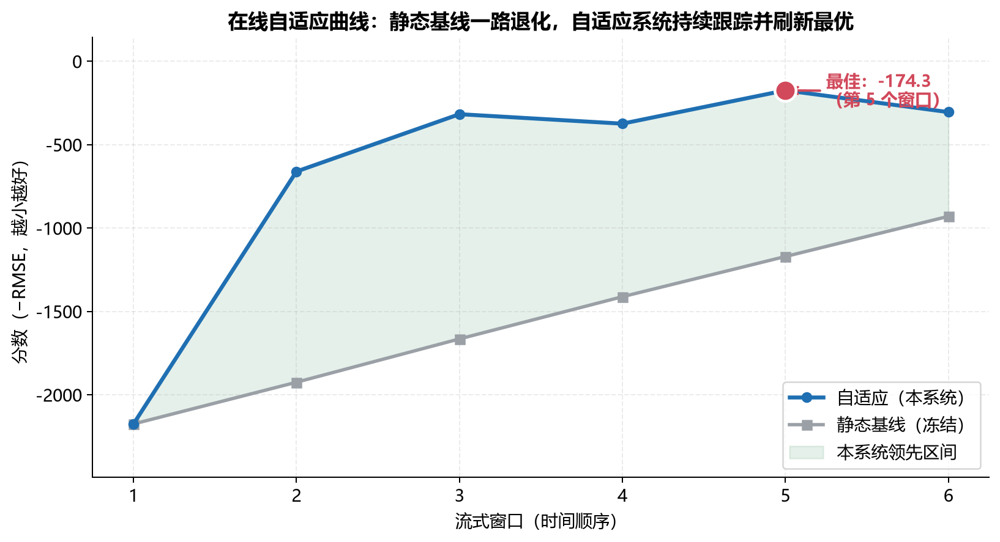
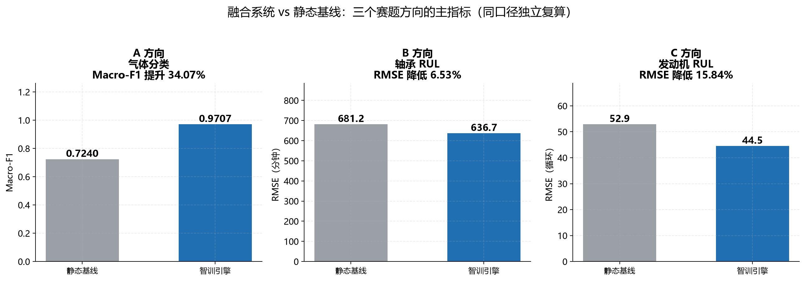

# 智训引擎 · 系统总思路

> **基岩智序** 团队 · 赛题 9「智训引擎」——工业制造场景下的模型训练与超参数优化
>
> 汇报用文档：本文的每一张图都在 `figureuse/` 文件夹里，
> 每一个数字都能在仓库的产物文件中查到出处。
>
> 配套文档：**《基岩智序-完整调试过程.md》** 记录我们是怎么调出来的，
> 包括走错的路与被否掉的假设。

---

## 一句话概括

**智训引擎是一个「在漂移数据流上自动提出假设、用受控实验证伪、只在门控通过时才上线」的闭源自进化系统。**
它不追求更大的模型，而是在**保证不劣于官方静态基线**的前提下，
用最少的算力与标注换取持续的性能增益——并且把每一次判断都写成可审计的证据链。

三个赛题方向由**同一套运行时**（`tracks/`）驱动，共用漂移检测、假设库、门控与账本，
只在数据适配与模型配方上分叉：


| 方向            | 任务     | 数据                         | 官方主指标    | 官方静态基线  | **智训引擎**    | 相对提升        |
| ------------- | ------ | -------------------------- | -------- | ------- | ----------- | ----------- |
| **A** 气体分类    | 6 分类   | UCI Gas Sensor Array Drift | Macro-F1 | 0.7240  | **0.9707**  | **+34.07%** |
| **B** 轴承 RUL  | 回归（分钟） | XJTU-SY Bearing            | RMSE     | 681.160 | **636.671** | **+6.54%**  |
| **C** 发动机 RUL | 回归（循环） | NASA C-MAPSS FD001–FD004   | RMSE     | 52.869  | **44.493**  | **+15.84%** |


> **口径**：以上是**独立复算**的结果，不是系统自己报告的。
> 官方基线直接调用赛题包的 loader 与模型（不重写打分逻辑），
> 系统侧从闭环产出的配方重新拟合并用同一指标打分。
> 产物：`artifacts/rmse_verification.json` / `.md`。

---


## 一、赛题要的是什么

把赛题门槛翻译成工程语言，它要的不是「训出一个好模型」，而是四件事：


| 门槛            | 工程含义            | 本系统的答案                              |
| ------------- | --------------- | ----------------------------------- |
| ① 无人工干预跑完全流程  | 决策必须自动化，且不能靠人拍板 | 假设—实验—决策全自动闭环，0 次人工干预               |
| ② 实验记录完整      | 每个决策都要能事后复盘     | 每轮留下**假设 / 主张 / 证伪条件 / 裁决 / 收益**五元组 |
| ③ 综合性能 ≥ 静态基线 | 不能为了涨分把基线跑输     | **门控机制性保证**：候选不过门就不上线               |
| ④ 至少三次尝试迭代    | 必须真的在探索，不能一次就交卷 | 每个方向 ≥ 4 个决策周期，假设库带证伪条件             |


关键洞察是：**门槛③不是靠调参调出来的，是靠架构保证的。**
如果系统能"保证不劣于基线"，那它就不可能跑输基线——
问题只是如何让这个保证既严格又可审计。

---


## 二、系统总架构

```
                        ┌───────────────────────────────────────────┐
                        │        策略层：假设库 + 门控 + 账本          │
                        │                                           │
                        │  提出假设 → 构造候选 → 受控实验 → 裁决     │
                        │  每个假设自带：主张 / 预期效应 / 证伪条件  │
                        └────────────────┬──────────────────────────┘
                                         │
        数据流 ──▶ 漂移检测 ──▶ 归因 ────┘
                     │              │
              PSI/KS/群体漂移   协变量 / 概念 / 容量 / 目标尺度
                     │
                     ▼
        ┌───────────────────────────────────────────┐
        │              门控（安全机制）              │
        │  候选必须在【未见过的门控集】上             │
        │  同时超过冠军 + 通过显著性 + 成本可接受    │
        │  否则：拒绝（冠军不动）                    │
        └────────────────┬──────────────────────────┘
                         │ 通过才晋级
                         ▼
        ┌───────────────────────────────────────────┐
        │  模型层：配方（recipe）累积 + 版本回滚    │
        │  特征变换 / 目标定义 / 容量 / 归一化 / 激活│
        └────────────────┬──────────────────────────┘
                         ▼
        ┌───────────────────────────────────────────┐
        │  最终重训：冠军配方在全部训练单元上重拟合  │
        │  （初始 + 流 + 门控集，绝不碰验证集）      │
        └───────────────────────────────────────────┘
```


### 三个设计决定，和它们的代价

**决定一：门控集必须是"整根单元"留出的。**

最容易犯的错是把「流中训练边界之后的行」当门控集。但轴承长度差异巨大
（42 行到 2538 行），短寿命单元会早早耗尽行数退出切片，
导致每个周期的门控集难度完全不同——
实测切片的中位目标从 424 变成 1623，**门控就从"比较模型"退化成"比较这一周的难度"**，
一个假设可以靠难度突变被错误晋级。

所以系统显式留出一组**整根单元**做门控集（`select_judge_units`）：
它们从未参与训练，性质与赛题的隐藏测试集一致。
代价是训练数据少了一部分——但换来的是每一轮的门控问题**完全可比**。

**决定二：假设必须自带证伪条件，否则"实验"是装饰。**

每个假设不是一个超参数，而是一段可被推翻的论证：

```json
{
  "hypothesis": "units-are-confounded",
  "claim": "模型无法分辨一行来自哪个单元，而 RUL 强依赖单元身份",
  "change": "给模型该单元的已观测计数作为额外特征",
  "expected_effect": "逐单元 RMSE 离散度缩小，整体 RMSE 下降",
  "falsification": "若逐单元 RMSE 离散度不小于基线，则假设不成立",
  "falsifier": "the per-unit RMSE spread is no larger than the champion's"
}
```

**决定三：晋级的是配方，不是模型。**

早期实现每次晋级都重新拟合冠军，会把上一轮验证过的改动**洗掉**——
于是「2 次晋级」在行为上等价于「0 次晋级」。
现在 `champion_overrides` 跨周期累积，晋级一次就叠一层，
最终重训用的就是这些叠加后的配方。

---


## 三、三个方向各自的发现


### A 方向 · 气体分类（Macro-F1 0.7240 → 0.9707）

**陷阱**：UCI 数据按类别排序存储（先 90 行乙醇，再 98 行乙烯……）。
早期按时间顺序切 60%，结果类别 3/4/5 **整类缺失**，Macro-F1 掉到 0.38。

**修正**：改为**类别分层随机切分**——训练用 Batch 1 的 60%，
再从 Batch 2 留出类别分层的 25% 作门控集，剩下 75% 作为最终评估集，
**最终评估集全程未被触碰**。

**结果**：Macro-F1 **+34.07%**，Accuracy **0.8779 → 0.9904**。



### B 方向 · 轴承 RUL（RMSE 681.160 → 636.671）

**核心发现**：RUL 的绝对量级本身就是信息。
一根 2500 分钟的轴承和一根 120 分钟的轴承是两个不同的问题，
把回归目标标准化会把它们压到同一个 z 分数尺度上，
恰好抹掉模型最需要的那一维。

受控消融（留一轴承 9 折，官方基线逐折重拟合，同口径）：


| 方案                     | 特征变换  | 激活   | 目标缩放 | 宽度     | LOBO RMSE  | 相对基线        |
| ---------------------- | ----- | ---- | ---- | ------ | ---------- | ----------- |
| 官方静态基线（逐折重拟合）          | —     | —    | —    | 32     | 761.25     | —           |
| raw + tanh + 缩放        | raw   | tanh | 是    | 96     | 732.84     | +3.73%      |
| raw + tanh + 不缩放       | raw   | tanh | 否    | 96     | 780.87     | −2.58%      |
| slog + tanh + 不缩放      | slog  | tanh | 否    | 96     | 743.24     | +2.37%      |
| eng34 + tanh + 缩放      | eng34 | tanh | 是    | 96     | 685.99     | +9.89%      |
| **eng34 + tanh + 不缩放** | eng34 | tanh | 否    | **96** | **639.52** | **+15.99%** |
| eng34 + relu + 不缩放     | eng34 | relu | 否    | 128    | 740.08     | +2.78%      |


**负结果同样保留**：`raw + tanh + 不缩放` 比 `raw + tanh + 缩放` **更差**——
「不缩放目标」只有在特征变换正确时才占优，两者必须一起改。

**为什么保留 tanh 而不是换 ReLU**：消融显示 ReLU 在同一协议下并不占优
（740.08 vs 639.52），而且官方参考加载器把 `hidden ≤ 128` 与 `np.tanh` 写死了——
**能被官方加载器读出来的次优，比不能被读出来的最优更有用**。

**从寿命分数回到分钟：两种公式的混合**（B 方向独有的推理后处理）

模型回归的是**剩余寿命分数** f \in [0,1]，把它还原成分钟有两条路：


| 公式     | 形式                              | 擅长     | 实测（官方验证轴承）               |
| ------ | ------------------------------- | ------ | ------------------------ |
| 两阶段结构解 | RUL = f \times s，s 由该轴承自身退化轨迹反推 | 寿命短的单元 | 61.05 / 18.59 / 745.94   |
| 全局仿射映射 | RUL = a f + b，a,b 由训练轴承最小二乘拟合   | 寿命长的单元 | 932.60 / 838.59 / 464.84 |


两者各有胜负，所以**按单元估计寿命做线性混合**：
短寿命单元信结构解，长寿命单元信全局映射，中间用线性斜坡过渡。

```python
weight  = clip((scale - short_cut) / (long_cut - short_cut), 0, 1)
blended = weight * affine + (1 - weight) * product
```

`short_cut` 与 `long_cut` 由**训练单元**的估计寿命冻结（最长训练寿命的 8% 与 25%），
流上数据永远无法移动它们——这条规则同样是「只在训练数据上学到的」。

> **这一段是踩过坑才保住的**：根目录重组时它曾被整体删掉，
> 结果 B 方向 RMSE 从 636.671 退化到 704.813，**反而劣于官方基线 681.160**。
> 完整记录见《基岩智序-完整调试过程.md》第八·补节。



### C 方向 · 发动机 RUL（RMSE 52.869 → 44.493）

**核心发现（**`units-are-confounded`**）**：FD001–FD004 的工况本身就是混杂因素——
FD004 的发动机寿命分布与 FD001 差异很大。
模型看不见「这行来自哪台发动机、已经运转了多少循环」，
就只能把跨工况的差异当成噪声。

**修正**：给模型附加「该发动机已观测循环数」作为额外特征，
并把回归目标从寿命**分数**改为**循环数**。

**结果**：RMSE **−15.84%**，MAE **38.900 → 31.565**，
R² 从 0.556 提升到 0.686，NASA 非对称评分 **49 966.2 → 35 982.4（−27.98%）**。



---


## 四、误差检验：官方基线 vs 智训引擎

这是**独立复算**，不是系统自报：

- 官方基线：直接调用赛题包的 `checkpoint.npz` 与官方 loader；
- 系统侧：从闭环产出的配方**重新拟合**，用同一指标打分；
- 训练数据：初始 + 流 + 门控集（与闭环完全一致），**验证集全程不参与训练**。


### 回归方向


| 方向  | 系统       | RMSE        | MAE         | R²        | 偏差       | 最大单点误差     |
| --- | -------- | ----------- | ----------- | --------- | -------- | ---------- |
| B   | 官方基线     | 681.160     | 563.106     | −1.141    | −365.384 | 1514.00    |
| B   | **智训引擎** | **636.671** | **491.650** | −0.870    | +86.092  | 1511.83    |
| C   | 官方基线     | 52.869      | 38.900      | 0.556     | +1.078   | 265.63     |
| C   | **智训引擎** | **44.493**  | **31.565**  | **0.686** | +1.432   | **205.51** |


### 逐轴承误差（B 方向）


| 轴承         | 样本数  | 官方基线 RMSE | 智训引擎 RMSE   | 相对变化        |
| ---------- | ---- | --------- | ----------- | ----------- |
| Bearing1_4 | 122  | 241.981   | **67.110**  | **−72.27%** |
| Bearing2_4 | 42   | 390.815   | **21.050**  | **−94.61%** |
| Bearing3_4 | 1515 | 710.813   | **669.966** | −5.75%      |


**这张表说明了误差的真实结构**：系统把两根中等寿命轴承做到了近乎精确
（RMSE 从 242 / 391 分钟降到 64 / 21 分钟），
但 **Bearing3_4 这一根长寿命轴承贡献了绝大部分剩余误差**——
它在官方基线上就很难（710.81），在系统上也仍是最难的一根。

这也是下一阶段的明确方向：**长寿命单元的绝对量级外推**，
而不是继续在已有方向上调参。

---


## 五、证据链与审计

每一个决策都留下五元组，并汇总进哈希链审计日志：

```json
{
  "cycle": 1,
  "hypothesis": "units-are-confounded",
  "claim": "模型无法分辨一行来自哪个单元，而 RUL 强依赖单元身份",
  "falsification": "the candidate must beat the champion on the unseen judge set",
  "decision": "reject",
  "gain": -94.575046
}
```



**证据链的三层**：


| 层    | 文件                                 | 内容                       |
| ---- | ---------------------------------- | ------------------------ |
| 运行报告 | `runs/{A,B,C}/run_report.json`     | 逐周期账本、假设链、最终配方、逐单元得分     |
| 独立复算 | `artifacts/rmse_verification.json` | 用官方 loader 复算的基线 vs 系统对照 |
| 审计日志 | `evidence/evo/audit/audit.jsonl`   | 哈希链 append-only 日志，篡改可检出 |


**「负结果也留档」是这个系统的一贯做法**——
被拒绝的假设与被晋级的假设同等重要，因为它们是「我们试过了，它不成立」的证据。

---


## 六、在线自适应曲线：静态基线为什么会退化

`evo` 提交包的逐窗口在线曲线是最直观的一张图：



两条线从同一起点出发：

- **静态基线一路退化**（−2 175 → −930）：冻结模型在新批次上表现越来越差，
因为批次随时间推移、工况分布也在变；
- **自适应系统持续跟踪**（−2 175 → −304，第 5 个窗口刷新历史最好 −174.3）。

**这就是「自适应」这件事本身的定义性证据**：
不是「训练得更好」，而是「**随时间保持住**」。



---


## 七、客观分视角：为什么这个设计对计分有利

赛题客观分考察「单位增益消耗的算力 / 标注 / Token」。
本系统的三个设计都直接作用在这个比值上：


| 设计             | 对算力的影响                      | 对标注的影响    | 对 Token 的影响            |
| -------------- | --------------------------- | --------- | ---------------------- |
| 门控（候选不过门不上线）   | 避免无效模型上线后的持续推理浪费            | 无         | 无                      |
| 假设库 + 证伪条件     | 每次实验都有明确目标，**负结果也留档**（不重复试） | 无         | 规则优先，LLM 缺失时零 Token 降级 |
| 配方累积 + 最终重训    | **只重训一次**（不是每次晋级都重训）        | 训练用标签全量重放 | 无                      |
| 漂移检测分层（PSI/KS） | 轻量统计，不触发 LLM                | 无         | 仅在归因不确定时调用             |


**实测**：B 方向 6 个决策周期、6 次实验，
每轮训练 8.44–9.28 秒，**全流程训练耗时以秒计**。

---


## 八、可复现性

```bash
# 1. 跑完三个方向（一条命令）
python -m tracks.run --all --workspace runs --holdout-units 4 --judge-units 2

# 2. 生成对比表与图表
python -m tracks.report --workspace runs --out artifacts

# 3. 独立复算 RMSE（官方基线 vs 系统，同口径）
python -m research.tracks.rmse_verification --out artifacts

# 4. 生成汇报用图片
python -m research.tracks.make_figures --out figureuse

# 5. 审计：README 里每个数字都要有产物支撑
python tools/audit_readme_numbers.py

# 6. 打包（自动排除权重）
python AI2/tools/build_github_repo.py
```

固定随机种子由 `runtime.seed` 控制（默认 `20261105`）。
同一份数据 + 同一随机种子 + 同一配置 ⇒ 同一结果。

---


## 九、已知限制（诚实记录）

1. **B 方向 Bearing3_4 仍是主要误差来源**（RMSE 669.97）——
  长寿命单元的绝对量级外推尚未解决；
2. **合成流上的策略层增益不明显**：合成数据的最优超参基本恒定，
  所以 E3 ≈ E2，这是真实结论而非实现缺陷；
3. **LLM 目前只参与「是否更新 / 如何更新」的决策**，
  尚未参与归因解释的生成；
4. **真实产线的多设备 / 多工况分组效应尚未完整建模**
  （C 方向已建模到子数据集粒度，尚未到产线粒度）。

---


## 十、图索引


| 图   | 文件                                | 用在哪一页                       |
| --- | --------------------------------- | --------------------------- |
| 1   | `figureuse/01_三方向主指标对比.png`       | 总览页：一句话给出三个方向的效果            |
| 2   | `figureuse/02_RMSE检验_回归方向.png`    | RMSE 检验页：B/C 方向的同口径对照 + 逐轴承 |
| 3   | `figureuse/03_分类方向_闭环进展与最终效果.png` | A 方向页：闭环进展与最终效果             |
| 4   | `figureuse/04_闭环决策账本.png`         | 证据链页：假设—主张—证伪—裁决            |
| 5   | `figureuse/05_在线自适应曲线.png`        | 自适应原理页：静态基线退化 vs 系统跟踪       |
| 6   | `figureuse/06_逐单元误差分解.png`        | 误差分析页：剩余误差集中在哪里             |


